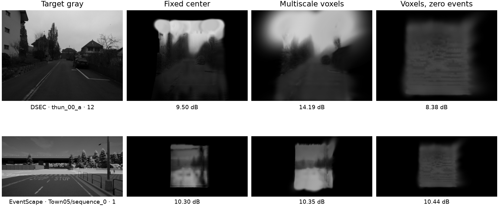
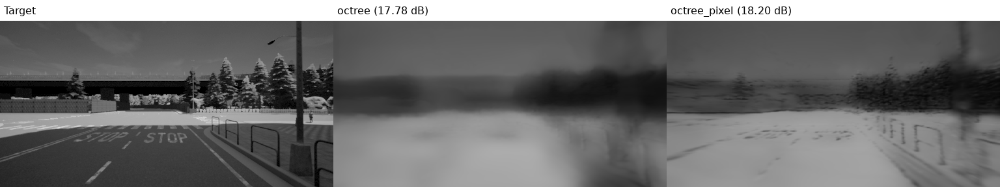

# 11.28 研究进展汇报

## 一、总体进展

完成 DSEC 两组各 22,522 步、EventScape 三组各 20,000 步的事件 DVLT 蒸馏，以及 MVSEC day1 的 10,721 步适配。在 DSEC 和 EventScape 的 4,034 个单目时序窗口上，固定中心和多尺度体素高斯头各训练 12,000 步。

多尺度体素在 DSEC 和 EventScape 上分别提高 **2.97 dB** 和 **0.46 dB**，高斯数中位数减少 **74.11%** 和 **65.27%**。MVSEC 跨域结果仍有两处短板：体素头的真实事件 PSNR 低于全零输入，且两种 LPIPS 均落后于 EvGGS。保尺度、等数量实验也未显示事件边界选叶的收益。 [11.18 研究设计](11.18.md) · [逐窗结果与训练记录](1128_results.md)

11.28 晚补充：定位并修复了源相机协议错配。训练用参考相机、测试用 DVLT 射线拟合相机，导致 DSEC/EventScape NVS 只有 12.04/9.35 dB；改为“已知传感器内参 + 事件预测的相对源位姿”后恢复到 **17.56/17.88 dB**。外观头改为 octree + per-pixel colour 后，EventScape 到 **18.20 dB / LPIPS 0.563**；但同一颜色头在 DSEC zero-shot 只有 7.44 dB，混合训练 held-out 为 **17.39/17.93 dB**。VG²GT-style fine-voxel/octree hybrid 均为负结果。

## 二、工作成果

表中 ↑/↓ 表示指标方向。Δ 行按指定基准计算相对变化，正值表示改善，负值表示退步。PSNR 同时给出 dB 差和平均 dB 数值的相对变化。— 表示没有对应结果。

### 1. 蒸馏几何：深度、点图与位姿

**表 1　Déjà-Events 论文主表与本地几何对照。** 论文数值取表 I（深度）、II（位姿）、III（点图）。Δ 以同一数据集的 Déjà-Events 论文值为分母，表示当前数值差。训练域、输入序列和参考位姿存在差异，表中百分比仅用于定位差距。

| 数据集 | 方法或协议 | 深度 AbsRel ↓ | δ1 ↑ | 点图 AbsRel ↓ | 点图 Inl@25% ↑ | ATE (m) ↓ | AUC@20° ↑ |
|---|---|---:|---:|---:|---:|---:|---:|
| DSEC | Déjà-Events（零样本，18 帧单目） | 0.145 | 0.841 | 0.148 | 0.855 | 0.105 | 0.811 |
| DSEC | EPF 有 F³（DSEC 蒸馏，168 个双目窗） | 0.1589 | 0.7733 | 0.2121 | 0.7448 | — | 0.2038 |
| DSEC | Δ EPF 相对论文 | −9.59% | −8.05% | −43.34% | −12.88% | — | −74.87% |
| EventScape | Déjà-Events（Town05） | 0.144 | 0.843 | 0.202 | 0.789 | 0.036 | 0.887 |
| EventScape | EPF SAAG + REALM（Town05） | 0.1718 | 0.7705 | 0.4230 | 0.2414 | 0.09112 | 0.7124 |
| EventScape | Δ EPF 相对论文 | −19.31% | −8.60% | −109.39% | −69.41% | −153.10% | −19.68% |
| MVSEC | Déjà-Events（零样本，四段户外） | 0.298 | 0.608 | 0.297 | 0.575 | 0.095 | 0.717 |
| MVSEC | EPF EventScape 蒸馏（零样本，night1） | 0.3946 | 0.5594 | 0.4344 | 0.3162 | 0.3594 | 0.6628 |
| MVSEC | Δ EPF 相对论文 | −32.42% | −8.00% | −46.28% | −45.01% | −278.37% | −7.55% |

DSEC 本地点图 AbsRel 取 Sim(3) 对齐后的相对 L2。EventScape 本地深度用 1,368 窗，点图和位姿用 RGB-D 相机参考通过检查的 948 窗。MVSEC 的 day1 适配同序列参照见表 4。MVSEC 主表覆盖一段白天和三段夜间，night2、night3 用于补齐夜间覆盖。 [Déjà-Events 表 I–III](https://arxiv.org/html/2611.21302v1#S5) · [DSEC 本地数据](../results/dsec_full/paired_geometry.json) · [EventScape 与 MVSEC 本地数据](../results/nov28_completed.json)

**表 2　DSEC 留出双目几何。** 168 个同窗，来自 7 条序列。两组训练样本和递推日程一致。

| 方法 | 深度 AbsRel ↓ | δ1 ↑ | 点图 Rel. L2 ↓ | 点图 Inl@25% ↑ | AUC@20° ↑ |
|---|---:|---:|---:|---:|---:|
| EPF 无 F³ | 0.1622 | 0.7653 | 0.2168 | 0.7359 | 0.1774 |
| EPF 有 F³ | **0.1589** | **0.7733** | **0.2121** | **0.7448** | **0.2038** |
| Δ 有 F³ 相对无 F³ | +2.04% | +1.04% | +2.14% | +1.21% | +14.86% |

F³ 改善深度和点图。AUC@20° 虽上升，逐序列重采样的 95% 区间跨零，平移方向仍是主要误差来源。[本地几何结果](../results/dsec_full/paired_geometry.json) · [位姿诊断](../results/dsec_full/paired_pose_diagnosis.json) · [Déjà-Events 对照](deja_events_comparison.md)

**表 3　EventScape Town05 蒸馏消融。** 深度使用全部 1,368 窗。点图和位姿使用相机参考通过检查的 948 窗。

| 方法 | 深度 AbsRel ↓ | δ1 ↑ | 点图 AbsRel ↓ | ATE (m) ↓ | AUC@20° ↑ |
|---|---:|---:|---:|---:|---:|
| RGB DVLT 教师 | 0.1474 | 0.8384 | 0.3874 | 0.06025 | 0.7407 |
| 直接蒸馏 | 0.1742 | 0.7777 | 0.4219 | 0.09173 | 0.7129 |
| 仅 SAAG | 0.1740 | 0.7790 | — | — | — |
| SAAG + REALM | 0.1718 | 0.7705 | 0.4230 | 0.09112 | 0.7124 |
| Δ 仅 SAAG 相对直接蒸馏 | +0.14% | +0.17% | — | — | — |
| Δ SAAG + REALM 相对直接蒸馏 | +1.40% | −0.93% | −0.25% | +0.67% | −0.07% |

仅 SAAG 的深度变化很小。联合组降低了全测试集 AbsRel，但 δ1 和点图误差略退。Déjà-Events 表 VI 中，完整 SAAG 相对仅蒸馏的 AbsRel 改善 2.04%，δ1 改善 0.48%，ATE 持平。 [本地蒸馏结果](../results/nov28_completed.json) · [Déjà-Events 表 VI](https://arxiv.org/html/2611.21302v1#S5.SS6)

**表 4　MVSEC 户外 night1。** 本地使用 146 个同窗，论文值来自 Déjà-Events 表 IV。论文与本地的整流、参考和窗口筛选有差异，Δ 行均用各自的适配前结果作基准。

| 方法 | 深度 AbsRel ↓ | δ1 ↑ | 点图 AbsRel ↓ | ATE (m) ↓ | AUC@20° ↑ |
|---|---:|---:|---:|---:|---:|
| EPF 本地灰度教师 | 0.3570 | 0.4919 | 0.4154 | 0.1813 | 0.6609 |
| EPF EventScape 蒸馏 | 0.3946 | 0.5594 | 0.4344 | 0.3594 | 0.6628 |
| EPF + day1 适配 | 0.3482 | 0.5233 | 0.4354 | 0.2479 | 0.6319 |
| Δ EPF 适配后相对适配前 | +11.75% | −6.44% | −0.22% | +31.04% | −4.66% |
| RGB DVLT 教师（论文） | 0.339 | 0.507 | 0.424 | 0.156 | 0.823 |
| Déjà-Events（论文） | 0.373 | 0.565 | 0.347 | 0.065 | 0.790 |
| Déjà-Events + day1（论文） | 0.324 | 0.567 | 0.418 | 0.066 | 0.821 |
| Δ Déjà-Events 适配后相对适配前 | +13.14% | +0.35% | −20.46% | −1.54% | +3.92% |

本地 day1 适配改善了 AbsRel 和 ATE，δ1 和 AUC 却下降。室内 431 个时序窗的 F³ 消融也有类似取舍：AbsRel 改善 15.7%，AUC@20° 下降 6.4%。 [户外结果](../results/nov28_completed.json) · [室内 F³ 消融](../results/dsec_full/paired_mvsec_geometry.json) · [Déjà-Events 表 IV](https://arxiv.org/html/2611.21302v1#S5.SS4)

### 2. 单目时序新视角合成

固定中心和体素头共用冻结的事件 DVLT、训练样本和训练步数。每个窗口从同一事件相机的两个时刻输入，在中间目标时刻渲染灰度图。

**表 5　DSEC 与 EventScape 留出测试。** DSEC 的 21 窗来自一条测试序列。EventScape 有 463 窗。

| 数据集 | 方法 | PSNR (dB) ↑ | SSIM ↑ | LPIPS-VGG ↓ | LPIPS-Alex ↓ | 高斯数中位数 ↓ |
|---|---|---:|---:|---:|---:|---:|
| DSEC | 固定中心 | 9.0703 | 0.3014 | **0.6573** | 0.7039 | 614,400 |
| DSEC | 多尺度体素 | **12.0427** | **0.4780** | 0.6661 | **0.6725** | **159,067** |
| DSEC | Δ 体素相对固定中心 | +2.972 dB（+32.77%） | +58.56% | −1.33% | +4.45% | +74.11% |
| EventScape | 固定中心 | 8.8917 | 0.1177 | 0.7186 | 0.8467 | 614,400 |
| EventScape | 多尺度体素 | **9.3539** | **0.1670** | **0.7082** | **0.8264** | **213,355** |
| EventScape | Δ 体素相对固定中心 | +0.462 dB（+5.20%） | +41.87% | +1.44% | +2.39% | +65.27% |

体素头在两域均提高 PSNR 和 SSIM，并减少高斯数量。DSEC 的 LPIPS-VGG 小幅退步。体素头的真实事件相对全零事件，PSNR 在 DSEC 和 EventScape 分别高 3.721 dB 和 0.411 dB。 [多场景结果](../results/multiscene_gaussians_final.json)

图中选取每个数据集清单的首个测试窗口。两张图都可见模糊和覆盖不足。EventScape 这一窗全零组的 PSNR 略高，表 5 报告全部测试窗的均值。

冻结体素头、只替换源相机内外参后，DSEC 和 EventScape 的 PSNR 分别提高 **5.63 dB** 和 **8.56 dB**。EventScape 的高斯画面覆盖率从 **25.64%** 恢复到 **99.72%**，纹理仍偏模糊。配对续训中，VGG 监督改善了三域 LPIPS，同时三域的 SSIM 都下降。 [相机对照图](../paper/eventscape_camera_control.png) · [相机全部指标](../results/gaussian_camera_control.json) · [续训全部指标](../results/attribute_supervision_final.json)

**表 6　MVSEC 室内跨域测试。** 72 个共享窗口，统一提供标定源位姿。EvGGS 使用官方权重。

| 方法 | PSNR (dB) ↑ | SSIM ↑ | LPIPS-VGG ↓ | LPIPS-Alex ↓ |
|---|---:|---:|---:|---:|
| EvGGS | 12.4706 | 0.0526 | **0.6558** | **0.5430** |
| EPF 固定中心 | **13.6011** | 0.2996 | 0.6951 | 0.7120 |
| EPF 多尺度体素 | 12.5985 | **0.3053** | 0.7198 | 0.7441 |
| Δ 固定中心相对 EvGGS | +1.131 dB（+9.07%） | +0.2470（+469.24%） | −5.99% | −31.11% |
| Δ 体素相对 EvGGS | +0.128 dB（+1.03%） | +0.2527（+480.11%） | −9.76% | −37.03% |

EvGGS 的 SSIM 基值较小，表中同时报告绝对差。两种 EPF 头的 LPIPS 都落后于 EvGGS。改用预测源位姿时，体素头相对固定中心低 1.242 dB（−8.78%）。三套主数据的 NVS 指标均在灰度目标上计算。 [完整相机对照](../results/multiscene_gaussians_final.json) · [EvGGS 权重及评测口径](evggs_baseline.md)

[查看 MVSEC 同帧对比图](../paper/mvsec_evggs_nvs.png)。每条航线按原评测顺序选首、中、尾三个窗口，列出真值、EvGGS、EPF 体素和 EPF 全零输入。9 个示例中，EvGGS 有 6 张全黑渲染，EPF 真实事件保留了部分轮廓，但细节仍模糊。全零结果在这些示例的 PSNR 较高，画面结构却与目标差异明显。

### 3. 事件特征与边界消融

**表 7　MVSEC 体素头输入干预。** 72 个窗口，源和目标相机一致。前两行的真实深度和高斯中心逐窗一致。

| 深度来源 | DVLT 特征来源 | PSNR (dB) ↑ | SSIM ↑ | LPIPS-VGG ↓ | LPIPS-Alex ↓ |
|---|---|---:|---:|---:|---:|
| 真实事件 | 真实事件 | 12.6004 | 0.3052 | 0.7198 | 0.7451 |
| 真实事件 | 全零事件 | 15.8302 | 0.3884 | 0.7704 | 0.8192 |
| 全零事件 | 真实事件 | 12.6905 | 0.3039 | 0.7101 | 0.7163 |
| Δ 仅切换特征至全零 |  | +3.230 dB（+25.63%） | +27.25% | −7.03% | −9.94% |

只切换深度和置信度带来 +0.090 dB。全零输入的 PSNR 优势主要跟随属性头使用的 DVLT 特征，同时两种感知分数都变差。 [固定几何消融](../results/mvsec_depth_feature_controls.json)

**表 8　MVSEC 等数量选叶。** 保持原始深度尺度，两组各训练 5,000 步，逐窗使用相同数量的高斯。

| 选叶依据 | PSNR (dB) ↑ | SSIM ↑ | LPIPS-VGG ↓ | LPIPS-Alex ↓ |
|---|---:|---:|---:|---:|
| 点数 | **17.4527** | **0.4387** | **0.6835** | **0.7038** |
| 事件边界 | 17.3012 | 0.4365 | 0.6894 | 0.7109 |
| Δ 事件边界相对点数 | −0.152 dB（−0.87%） | −0.49% | −0.86% | −1.02% |

分时极性相对仅几何组的边界 F1 在 EventScape、DSEC 和 MVSEC 分别变化 +11.85%、+127.71%、−3.18%，但三域原始 DVLT 的边界带 AbsRel 都低于分时极性组。保尺度后，边界选叶也未提高 NVS。 [三数据集边界与等预算结果](1128_results.md#三事件边界及等预算选叶) · [原始数据](../results/nov28_completed.json)

### 4. 源相机协议与外观头

**表 9　源相机组件置换。** 固定同一冻结头，只替换源相机；DSEC 21 窗、EventScape 463 窗。覆盖率是 alpha≥0.5 的像素比例。

| 数据集 | 源相机 | PSNR (dB) ↑ | SSIM ↑ | LPIPS-VGG ↓ | 覆盖率 ↑ |
|---|---|---:|---:|---:|---:|
| DSEC | DVLT 射线拟合（旧） | 12.04 | 0.478 | 0.666 | 0.581 |
| DSEC | 只换内参 | **17.56** | 0.708 | **0.617** | 0.989 |
| DSEC | 只换位姿 | 12.03 | 0.478 | 0.666 | 0.581 |
| DSEC | 内参 + 位姿 | **17.67** | **0.717** | 0.610 | **0.990** |
| DSEC | 已知内参 + 预测位姿（主协议） | **17.56** | 0.708 | **0.617** | 0.989 |
| EventScape | DVLT 射线拟合（旧） | 9.35 | 0.167 | 0.708 | 0.256 |
| EventScape | 只换内参 | **17.88** | 0.592 | **0.619** | 0.997 |
| EventScape | 只换位姿 | 9.36 | 0.167 | 0.708 | 0.256 |
| EventScape | 内参 + 位姿 | **17.91** | **0.596** | 0.616 | **0.997** |
| EventScape | 已知内参 + 预测位姿（主协议） | **17.88** | 0.592 | **0.619** | 0.997 |

射线拟合的误差是系统性的，但位姿是准的：

| 数据集 | fx 比 | fy 比 | 主点误差 | 射线角误差 | 相对旋转 | 相对平移 |
|---|---:|---:|---:|---:|---:|---:|
| DSEC | 1.924 | 1.289 | 16.78 px | 7.84° | 0.765° | 0.230 m |
| EventScape | 3.426 | 1.535 | 10.02 px | 17.40° | 0.566° | 0.202 m |

只换内参就恢复几乎全部增益，说明射线头在事件域没有标定；主表应写“intrinsics calibrated, source poses predicted”，这比 EvGGS 的 GT source pose 更弱。 [相机全部指标](../results/gaussian_camera_components.json)

**表 10　深度与外观的误差分解。** 参考深度置换只改深度，不改相机；target-colour oracle 保留预测几何、只把每个高斯颜色换成目标帧投影颜色，不进主表，仅作上界诊断。

| 数据集 | 参考深度 ΔPSNR | 参考深度有效率 | 当前 PSNR | target-colour oracle |
|---|---:|---:|---:|---:|
| DSEC | −0.144 dB | 20.1% | 17.67 | **21.68** |
| EventScape | −0.149 dB | 78.6% | 17.56 | **26.86*** |

\* EventScape 为 12 窗抽样。深度不是当前 PSNR 的主因；DSEC 参考深度只有 20.1% 有效，置换对照本身偏弱。外观缺口约 4.0 dB（DSEC）/9.3 dB（EventScape），说明剩余误差主要在颜色头与大高斯的空间低频。 [深度对照全部指标](../results/gaussian_depth_control.json)

**表 11　target offset 与高斯头对照。** DSEC 21 窗、EventScape 463 窗；混合训练指 DSEC 训练序列 + EventScape，DSEC 测试序列 `thun_00_a` 留出。

| 数据集 | 方法 | target | PSNR (dB) ↑ | SSIM ↑ | LPIPS-VGG ↓ |
|---|---|---:|---:|---:|---:|
| DSEC | octree | 2 | 17.56 | 0.708 | **0.617** |
| DSEC | octree | 4 | **17.79** | **0.722** | 0.634 |
| DSEC | octree | 8 | 18.06* | 0.701 | 0.617* |
| DSEC | VG²GT fine-voxel | 4 | 11.86 | 0.625 | 0.657 |
| DSEC | VG²GT octree hybrid | 4 | 15.44 | 0.702 | 0.640 |
| DSEC | octree_pixel（混合） | 4 | 17.39 | 0.704 | 0.648 |
| EventScape | octree | 2 | **17.88** | **0.592** | **0.619** |
| EventScape | octree | 4 | 17.78 | 0.589 | 0.641 |
| EventScape | octree | 8 | 17.68* | 0.588 | 0.620* |
| EventScape | VG²GT fine-voxel | 4 | 17.72 | 0.588 | 0.657 |
| EventScape | VG²GT octree hybrid | 4 | 17.66 | 0.587 | 0.655 |
| EventScape | octree_pixel（EventScape-only） | 4 | **18.20** | **0.607** | **0.563** |
| EventScape | octree_pixel（混合） | 4 | 17.93 | 0.601 | 0.578 |
| EventScape | octree_pixel_center（EventScape-only） | 4 | 18.13 | 0.606 | 0.566 |

\* target 8 为 DSEC 9 窗 / EventScape 336 窗公共子集。target 4 相对 target 2 在 PSNR/SSIM 上基本持平，但 LPIPS 变差，不是净收益。

外观头的结论：

- **per-pixel colour 在 EventScape 上有效**：17.78→18.20 dB，LPIPS 0.641→0.563；渲染图从灰雾变成能看出 STOP、护栏、树和路面标线。
- **EventScape-only 颜色头在 DSEC zero-shot 失败**：7.44 dB，比全零事件 9.20 还低；混合训练恢复到 17.39 dB，但仍比 octree 低 0.40 dB。
- **VG²GT-style 两个变体都没赢**：fine-voxel 在 DSEC 崩到 11.86；octree hybrid 15.44；同窗 target-colour oracle 只有 12.62/16.02，而 octree 是 21.68。原因不是颜色，是 self-splitting 在没有 volume rendering/多样性约束时拖坏几何。
- **center-color 18.13 < leaf-average 18.20**，不保留。

当前 `octree_pixel_fine_es_12k`（2.5 cm 叶子，442k 高斯）和 `octree_pixel_deep_es_12k`（更深颜色 decoder）仍在训练；2k 验证点 fine 16.92 / LPIPS 0.554，5 cm 是 16.85 / 0.557，提升很小，尚不足以判断能否到 19。 [完整 run 清单](../results/run_manifest.json) · [训练与检查点记录](run_log.md) · [外观头设计](appearance_head_plan.md) · [VG²GT-style 负结果](vg2gt_head_results.md)

## 三、下一步计划

1. **先把 EventScape 推到 19–20。** 等 fine 2.5 cm 与 deep decoder 结果；若仍 <19，转更高分辨率 F³（cell 5→2/1）或 pixel-aligned head，而不是继续加步数。
2. **DSEC held-out 到 17.5+。** 用混合训练的 fine/deep 版本，`thun_00_a` 只测试；不再宣称 zero-shot。
3. **补外观监督。** 加入源视图渲染损失（不只监督目标帧）和 LPIPS/DISTS 训练项；当前 L1+SSIM 会把颜色场压成低频。
4. **做同协议对比表。** 固定目标背景（全灰/置黑）、裁剪、target frame、源位姿来源，再跑 EvGGS/IncEventGS。EvGGS 官方 29.3 dB 是 EV3DS 置黑背景，同批保留背景只有 11.55 dB，不能直接比。
5. **保留可复现记录。** 新 run 加 `--save-every` 留 `step_XXXXXX.pt`；`results/run_manifest.json`、`weights/`、`run_log.md` 已记录 4 个关键头。 [完整实验设计](paper_experiment_design.md)
