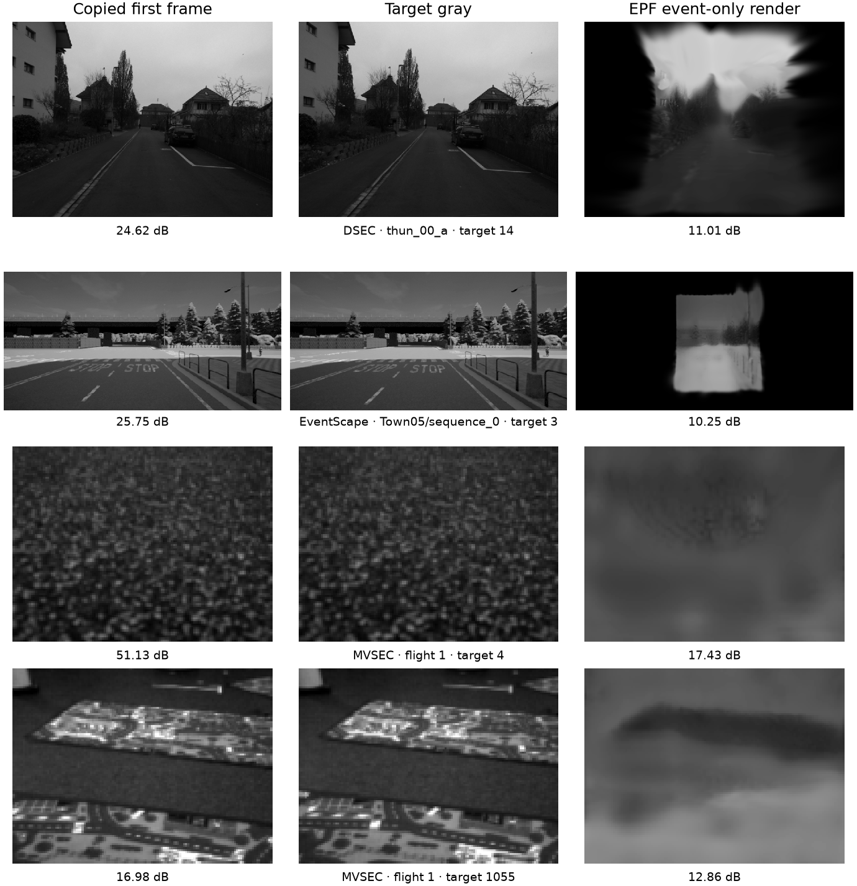

# 11.28 已完成实验与论文判断

以下比较使用已完成的服务器产物。正百分比表示改善。PSNR 使用 dB 差，其他百分比以对照原值为分母。训练和评测细节见进展汇报，逐项汇总见机器可读结果。 [11.28 汇报](1128.md) · [结果汇总](../results/nov28_completed.json)

## 一、DVLT 蒸馏与几何

EventScape 直接蒸馏和 SAAG + REALM 各 20,000 步。逐步核验了训练序列、帧索引及共享递推步数。Town05 的 1,368 个窗口和有效深度像素一致，深度上限是 200 m。

| 方法 | 全测试深度 AbsRel ↓ | 全测试 δ1 ↑ | 948 窗点图 AbsRel ↓ | 948 窗 ATE (m) ↓ | 948 窗 AUC@20° ↑ |
|---|---:|---:|---:|---:|---:|
| RGB DVLT | 0.1474 | 0.8384 | 0.3874 | 0.06025 | 0.7407 |
| 直接蒸馏 | 0.1742 | 0.7777 | 0.4219 | 0.09173 | 0.7129 |
| 仅 SAAG | 0.1740 | 0.7790 | — | — | — |
| SAAG + REALM | 0.1718 | 0.7705 | 0.4230 | 0.09112 | 0.7124 |
| 联合组相对直接蒸馏改善 | +1.40% | −0.93% | −0.25% | +0.67% | −0.07% |

点图和位姿使用全部相机通过 RGB-D PnP 检查的 948 / 1,368 个窗口，占 69.3%。同一子集的直接蒸馏和联合组深度 AbsRel 分别为 0.16869、0.16916。联合组的全测试 AbsRel 小幅改善，在有相机参考的子集上略退。仅 SAAG 的 20,000 步已完成。同窗相对直接蒸馏改善 AbsRel 0.14%、δ1 0.17%。联合组相对仅 SAAG 改善 AbsRel 1.26%，δ1 下降 1.09%。目前这两个指标的变化方向有分歧，支持保留蒸馏消融表。仅 SAAG 组已完成全测试深度评测，表中三维指标暂缺。 [三组蒸馏最终汇总](../results/eventscape_distillation_final.json)

MVSEC 户外使用 day1 的同帧灰度教师和事件做 10,721 步适配，在 night1 的 146 个相同 18 帧窗口比较。论文表 IV 单列作参照，本地的输入整流、参考及窗口筛选会影响绝对数值。 [Déjà-Events 表 IV](https://arxiv.org/html/2611.21302v1#S5.SS4)

| 方法 | AbsRel ↓ | δ1 ↑ | ATE (m) ↓ | AUC@20° ↑ | 点图 AbsRel ↓ |
|---|---:|---:|---:|---:|---:|
| 本地灰度教师 | 0.3570 | 0.4919 | 0.1813 | 0.6609 | 0.4154 |
| 本地 EventScape 蒸馏 | 0.3946 | 0.5594 | 0.3594 | 0.6628 | 0.4344 |
| 本地 day1 适配 | 0.3482 | 0.5233 | 0.2479 | 0.6319 | 0.4354 |
| 适配相对本地适配前改善 | +11.75% | −6.44% | +31.04% | −4.66% | −0.22% |
| 论文 Déjà-Events | 0.373 | 0.565 | 0.065 | 0.790 | 0.347 |
| 论文 Déjà-Events + day1 | 0.324 | 0.567 | 0.066 | 0.821 | 0.418 |

## 二、单目时序新视角

**MVSEC 协议修正。** 航线 4 单独拟合的高斯头仅用于检查代码、窄域拟合和选叶机制。该实验的训练源相机来自标定，评测源相机来自模型预测。真实事件和全零事件的平均 PSNR 差很小，且随运动幅度变化。现将 MVSEC 室内航线 1–3 的 72 个固定窗口保留为跨域测试，不再用仅在航线 4 拟合的分数支撑泛化主结论。

先在同一批 MVSEC 窗口评测只在 DSEC 或 EventScape 训练的现有头，再评测多场景共享头。共享训练使用 DSEC 的 34 条序列、1,938 个窗口，以及 EventScape 的 527 条序列、2,096 个窗口。固定中心和多尺度体素使用相同冻结 DVLT、相同输入帧和采样顺序，各训练 12,000 步。每轮先打乱、再不放回遍历，确保两次完整覆盖 4,034 个窗口，再跑第三轮前 3,932 个窗口。训练日志逐步保存序列、帧索引和损失，每个完整轮次保存留出验证指标。DSEC、EventScape 留出评测维持原画幅和清单，MVSEC 比较 EvGGS 官方权重、真实与全零事件及源灰度复制参照。当前这一轮集中纠正训练场景覆盖，源与目标仍沿用双源、单个中间目标协议。 [运行入口](../scripts/run_multiscene_gaussians.sh)

MVSEC 增加同窗源相机对照。对同一权重分别使用预测源相机和标定源相机，两种条件都跑真实与全零事件，四组共用目标相机和灰度图。这可以检查预测相机误差是否掩盖了真实事件的收益。固定相机后，事件仍同时影响预测深度与高斯特征。与 EvGGS 比较时保留相同源相机条件的原值，同时单列预测源相机结果。 [评测入口](../dvlt_real_transfer.py) · [汇总入口](../scripts/summarize_multiscene_gaussians.py)

同一批窗口还交换两段源事件在模型中的位置，保留事件总量、原始标定源相机顺序和目标相机。标定条件可检验模型是否利用了事件与源相机之间的对应。预测条件下，交换输入也会改变首相机坐标系，所以该组只作为顺序敏感性诊断。两种条件均计算正确对应相对交换输入的指标差和百分比。

最终汇总会直接比较混合训练的体素头与两个单域体素头，并在相同训练步数下比较混合训练的固定中心与体素头。前两组对照同时改变训练数据和步数，DSEC 单域组还使用了不同蒸馏权重，因此这些差值反映的是整套训练设置的变化。每项比较分别报告预测源相机和标定源相机条件下的结果。 [汇总入口](../scripts/summarize_multiscene_gaussians.py)

EvGGS 在 EV3DS 的 64 个训练对象上联合学习深度、灰度与高斯，预训练权重用于未见对象与真实场景。InfiniSplat v2 跨三个 RGB 数据集训练，采用独立验证场景、训练期相机尺度对齐和远角度目标采样。上述本地多场景训练借鉴场景隔离；判定更宽视角下的收益仍需要单独检验可见性与目标跨度。 [EvGGS §4.4–5.1](https://arxiv.org/html/2405.14959#S5.SS1) · [InfiniSplat v2 附录 A](https://arxiv.org/html/2610.20341v1#A1)

固定中心与多尺度体素头分别训练 5,000 步。DSEC 和 EventScape 使用离线 RGB-D 估计的目标查询相机，源相机在测试由事件模型预测。DSEC 清单的有效覆盖是训练 1,938 / 3,264、验证 92 / 144、测试 21 / 24。复制源帧是检验短时间间隔难度的参考，需要额外输入源灰度帧。

| 数据集 | 头 | 测试窗 | PSNR ↑ | SSIM ↑ | LPIPS-VGG ↓ | LPIPS-Alex ↓ | 高斯数中位数 |
|---|---|---:|---:|---:|---:|---:|---:|
| DSEC | 固定中心 | 21 | 9.024 | 0.3093 | 0.6583 | 0.7040 | 614,400 |
| DSEC | 多尺度体素 | 21 | 11.012 | 0.4588 | 0.6745 | 0.7004 | 160,355 |
| EventScape | 固定中心 | 463 | 9.004 | 0.1200 | 0.7058 | 0.8222 | 614,400 |
| EventScape | 多尺度体素 | 463 | 9.207 | 0.1439 | 0.7076 | 0.8231 | 213,403 |

DSEC 的体素头提高 PSNR 1.987 dB、SSIM 48.35%，LPIPS-VGG 退步 2.45%、LPIPS-Alex 改善 0.51%。EventScape 的提高为 0.203 dB、SSIM 19.94%，两种 LPIPS 分别退步 0.26% 和 0.11%。真实事件比全零事件的体素头 PSNR 分别高 2.430 和 0.228 dB。复制源帧的 PSNR 分别是 22.736 和 25.451 dB，显示短跨度下外观重建还有明显差距。MVSEC 的多尺度体素头在 72 窗得到 17.381 dB、SSIM 0.4384、LPIPS-VGG 0.6907、LPIPS-Alex 0.7245，同窗全零输入 PSNR 为 17.400 dB。EvGGS 官方权重在同组窗的分数见进展汇报。

将各数据集的测试窗按首帧到查询帧的相机位移等量分三组，复查真实事件与全零事件的差距。DSEC 使用同一 RGB 相机内部的时序位移，排除 RGB 与事件相机之间的安装基线。下表每个单元格依次列出短、中、长位移组。

| 数据集 | 每组窗口数 | 复制源帧 PSNR (dB) | 多尺度头真实事件相对全零 PSNR 差 (dB) |
|---|---:|---:|---:|
| DSEC | 7 / 7 / 7 | 22.31 / 22.93 / 22.97 | +2.48 / +2.79 / +2.02 |
| EventScape | 155 / 154 / 154 | 25.59 / 25.56 / 25.20 | +0.13 / +0.26 / +0.30 |
| MVSEC | 24 / 24 / 24 | 31.69 / 20.79 / 20.72 | −0.25 / +0.01 / +0.18 |

MVSEC 短位移组的复制源帧分数明显更高，说明运动范围会影响全窗平均结果。DSEC 所有位移组都有事件收益，但样本来自同一条测试序列。EventScape 的分组变化是探索性结果，位移与场景、曝光和遮挡共同变化。 [完整分组指标与位移范围](../results/temporal_nvs_motion.json) · [统计入口](../scripts/diagnose_temporal_nvs.py)

“复制源帧”直接将同一灰度相机的第 (i) 帧与第 (i+2) 帧计算 PSNR。它需要源灰度输入，无图像变换或 3DGS 渲染。MVSEC 航线 1 目标帧 4 的相机位移约 0.26 mm，复制得到 51.13 dB。目标帧 1055 的位移约 3.42 cm，复制分数降至 16.98 dB。DSEC 与 EventScape 的示例也可直接看出相邻画面保留了大量相同纹理。

图中 DSEC、EventScape 使用本节 5,000 步体素头的同窗渲染。MVSEC 右列使用后续 12,000 步混合体素头及标定源位姿，左列复制分数使用本节相同的源帧和目标帧。 [原图](../paper/source_copy_nvs_examples.png)

## 三、事件边界及等预算选叶

各行按「1 像素容差边界 F1 ↑ / 边界带 AbsRel ↓」报告。边界头在 EventScape 训练 5,000 步，再做同域和跨域测试。

| 数据集 | 窗 | 原始 DVLT | 仅几何头 | 累计事件 | 固定事件边缘 | 分时极性 |
|---|---:|---:|---:|---:|---:|---:|
| EventScape | 116 | 0.1381 / 0.3825 | 0.1410 / 0.4534 | 0.1875 / 0.4501 | 0.1433 / 0.4386 | 0.1577 / 0.4160 |
| DSEC | 168 | 0.0254 / 0.2572 | 0.0303 / 0.2827 | 0.0623 / 0.3135 | 0.0290 / 0.3011 | 0.0690 / 0.2901 |
| MVSEC | 72 | 0.0265 / 0.5068 | 0.0448 / 0.5684 | 0.0406 / 0.6047 | 0.0379 / 0.6201 | 0.0434 / 0.5554 |

分时极性相对仅几何头的边界 F1 在三数据集分别变化 +11.85%、+127.71%、−3.18%，边界带 AbsRel 相对改善 +8.24%、−2.62%、+2.28%。三个数据集上，原始 DVLT 的边界带 AbsRel 都更低。定位和恢复边界两侧深度仍需分别验证。

MVSEC 等数量重训使用同一边界校正与同一冻结骨干。点数选叶和事件选叶各 5,000 步，72 个测试窗逐窗使用相同高斯数量，真实事件组平均只有 9.51 个高斯。

| 选叶方式 | PSNR ↑ | SSIM ↑ | LPIPS-VGG ↓ | LPIPS-Alex ↓ |
|---|---:|---:|---:|---:|
| 点数 | 17.2151 | 0.4330 | 0.6688 | 0.7288 |
| 事件边界 | 17.2688 | 0.4375 | 0.6679 | 0.7269 |
| 事件选叶相对改善 | +0.054 dB | +1.04% | +0.14% | +0.27% |

逐窗口检查表明，这轮等预算比较每窗只有 6–17 个高斯，PSNR 在 39 / 72 个窗口提高。三条航线的平均 PSNR 变化分别为 −0.045、+0.106、+0.100 dB。全零事件时，事件选叶组的 LPIPS-VGG 仍在 62 / 72 个窗口改善，因此平均 LPIPS 收益也可能来自训练后的属性头差异。保尺度重训采用同样的逐窗与逐航线核验。 [逐航线与逐窗汇总](../results/mvsec_leaf_variation.json)

冻结头的另一组比较中，直接接入分时边界校正后，平均候选数由 198.19 降到 9.57。边界头的训练损失对整体对数深度偏移不敏感，而体素选叶依赖绝对空间尺度。重新评测显示，分时边界校正把尺度乘到了原深度的 0.028 倍（逐视图中位数）。恢复原尺度后，分时组平均有 669.38 个候选，高于原始头的 198.19 个。自然数量下，分时组 PSNR 从 17.381 升至 17.642 dB，但逐窗裁剪到与原始头相同数量后只剩 14.622 dB。这是冻结属性权重后的诊断。保持尺度的点数与事件选叶等数量重训已在 GPU 0 启动。

另在相同留出窗口上运行固定权重的输入干预。DVLT 骨干始终接收真实事件，分时边界头分别接收原始输入、倒序时间分箱、交换极性、保留正负极性各自计数但均摊至五个时间分箱的输入。每种干预保留每像素的事件总数。比较边界带深度误差和边界 F1，可检查分时头对真实时间顺序或极性的依赖。四组共用同一边界头，结果需结合独立训练的累计事件组解读。 [评测入口](../evaluate_event_depth_boundary.py)

EventScape 的 116 窗 CPU 对照已完成。相对原始时序，倒序使 1 px F1 下降 2.22%，极性交换下降 0.30%，均摊时间之后反而提高 2.28%。三种干预的边界带 AbsRel 变化均不足 0.20%。因此，这个边界头在 EventScape 上对时序的依赖较弱，现有结果还不能支撑把真实时间顺序作为主要贡献。DSEC 和 MVSEC 使用同一 CPU 评测口径。 [EventScape 干预结果](../results/eventscape_temporal_controls.json)

按 EventScape 的 116 条测试序列做 20,000 次配对重采样，倒序的 1 px F1 绝对变化为 −0.00355，95% 区间 [−0.00486, −0.00230]。均摊时间的绝对变化为 +0.00365，区间 [+0.00242, +0.00473]。极性交换的区间跨过零。各组边界带深度误差的绝对变化仍很小。这说明时序顺序对这个头的边界定位有可测但较小的影响，均摊后的结果也更好。 [逐项区间](../results/eventscape_temporal_intervals.json)

DSEC 的 168 个同窗检验也已完成。以同一 CPU 运行的原始分时输入为基准，倒序、极性交换和均摊时间的 1 px F1 分别变化 +0.61%、−4.23% 和 +10.53%。按 7 条序列重采样，均摊组的 F1 绝对增量为 +0.00728，95% 区间 [+0.00548, +0.00868]，边界带 AbsRel 同时上升 0.57%。这说明时序处理对边缘检测与两侧深度有不同影响。 [DSEC 干预结果](../results/dsec_temporal_intervals.json)

三套留出数据的时序干预已完成。下表是三种干预相对原始分时输入的变化，正值表示改善。DSEC 和 EventScape 的时间均摊提高了边界 F1，但边界带深度误差略升。MVSEC 三项干预对深度的影响均低于 0.04%，其重采样仅有三条航线，区间只反映这三条航线。 [MVSEC 完整结果](../results/mvsec_temporal_intervals.json)

| 数据集 | 窗口 | 倒序 F1 / AbsRel | 极性交换 F1 / AbsRel | 时间均摊 F1 / AbsRel |
|---|---:|---:|---:|---:|
| EventScape | 116 | −2.22% / +0.05% | −0.30% / −0.04% | +2.28% / −0.20% |
| DSEC | 168 | +0.61% / −0.15% | −4.23% / +0.03% | +10.53% / −0.57% |
| MVSEC | 72 | −0.15% / −0.001% | −0.83% / +0.002% | −0.009% / −0.032% |

## 四、SAAG 消融中间记录

三组的前 5,000 步逐步匹配了序列、帧索引和递推步数，均覆盖 525 条训练序列。第 4,001–5,000 步的平均训练 token 损失分别为直接蒸馏 0.19111、仅 SAAG 0.18851、SAAG + REALM 0.19894。直接组与仅 SAAG 组使用相同损失，联合组引入空间掩码与输入遮挡，损失值对应的监督范围不同。跨组几何改善以留出评测为准。 [逐千步训练记录](../results/eventscape_distillation_5k_progress.json)

## 五、保尺度等数量重训结果

保持原始 DVLT 深度尺度后，点数选叶与事件边界选叶各重训 5,000 步。MVSEC 室内三条留出航线的 72 个窗口逐窗核验高斯数量相同，真实事件组每窗 300–1,186 个高斯，平均 659.46 个。

| 选叶方式 | PSNR ↑ | SSIM ↑ | LPIPS-VGG ↓ | LPIPS-Alex ↓ |
|---|---:|---:|---:|---:|
| 点数 | 17.4527 | 0.4387 | 0.6835 | 0.7038 |
| 事件边界 | 17.3012 | 0.4365 | 0.6894 | 0.7109 |
| 事件边界相对改善 | −0.152 dB（−0.87%） | −0.49% | −0.86% | −1.02% |

事件边界选叶只在 26 / 72 窗提高 PSNR。三条航线的平均 PSNR 差分别为 −0.160、−0.151 和 −0.144 dB。原先每窗约 10 个高斯时的微弱收益，在修正尺度后未能复现。现阶段保留点数选叶为多场景训练基线，事件边界选叶列为消融。该结论覆盖单航线训练的设置，多场景版本仍待实测。 [数值与逐航线汇总](../results/nov28_completed.json)

## 六、单域训练头的 MVSEC 跨域诊断

两个 5,000 步多尺度体素头分别在 DSEC 和 EventScape 的多场景时序窗口上训练，均未用 MVSEC 高斯监督。以下使用同一批 72 个 MVSEC 窗口。括号内百分比为真实事件相对全零事件的平均 PSNR 变化。

| 高斯头训练域 | 测试源相机 | 真实事件 PSNR | 全零事件 PSNR | 交换两段事件 PSNR | 真实相对全零 |
|---|---|---:|---:|---:|---:|
| DSEC | 预测 | 14.664 | 16.660 | 14.666 | −1.996 dB（−11.98%） |
| DSEC | 标定 | 14.149 | 16.866 | 14.160 | −2.717 dB（−16.11%） |
| EventScape | 预测 | 10.985 | 14.077 | 10.982 | −3.092 dB（−21.96%） |
| EventScape | 标定 | 10.520 | 13.797 | 10.541 | −3.277 dB（−23.75%） |

固定标定源相机后，全零优势仍在。交换源事件的 PSNR 变化不足 0.022 dB。这说明预测源位姿误差无法单独解释现象，现有头对事件与相机的对应关系也缺少可测的 PSNR 收益。场景、传感器、外观监督与深度尺度仍可能影响跨域差距。以上保留为诊断，混合训练正式配对结果见下节。 [完整指标与 EvGGS 对照](../results/mvsec_multiscene_source_camera_controls.json)

## 七、多场景高斯头训练起点

固定中心头在更新参数前完成了 144 个验证窗。DSEC 的 27 窗真实事件和全零事件 PSNR 分别为 7.675 和 7.857 dB，EventScape 的 117 窗分别为 8.769 和 8.631 dB。12 个训练校准窗估计的全局深度乘数为 6.011，各窗单独估计的乘数分布为 3.864–9.899。该记录用于对比完整训练轮次后的变化，各域验证窗口数不均，汇总时按域报告。 [第 0 步验证记录](../results/multiscene_initial_validation.json)

固定中心头的前 1,200 步已与训练清单和固定随机种子逐项核验。DSEC 取到 561 个窗，覆盖 33 条序列。EventScape 取到 639 个窗，覆盖 412 条序列。两域的平均训练损失分别为 0.2457 和 0.1776。该记录确认混合数据都进入了优化，首轮验证安排在完整遍历 4,034 个窗口后。 [采样与损失记录](../results/multiscene_fixed_1200_progress.json)

## 八、多场景高斯头最终结果

两种头各训练 12,000 步。逐步确认它们共用相同骨干、相同顺序的 4,034 个训练窗口，并完整遍历两轮。DSEC 和 EventScape 的测试集整条序列留出，MVSEC 渲染测试使用未参与这两组头部训练的 72 个室内航线窗口。

| 数据集（窗口数） | 头 | PSNR ↑ | SSIM ↑ | LPIPS-VGG ↓ | LPIPS-Alex ↓ | 高斯数中位数 |
|---|---|---:|---:|---:|---:|---:|
| DSEC（21） | 固定中心 | 9.0703 | 0.3014 | 0.6573 | 0.7039 | 614,400 |
| DSEC（21） | 多尺度体素 | 12.0427 | 0.4780 | 0.6661 | 0.6725 | 159,067 |
| DSEC | 体素相对改善 | +2.972 dB（+32.77%） | +58.56% | −1.33% | +4.45% | −74.11% 数量 |
| EventScape（463） | 固定中心 | 8.8917 | 0.1177 | 0.7186 | 0.8467 | 614,400 |
| EventScape（463） | 多尺度体素 | 9.3539 | 0.1670 | 0.7082 | 0.8264 | 213,355 |
| EventScape | 体素相对改善 | +0.462 dB（+5.20%） | +41.87% | +1.44% | +2.39% | −65.27% 数量 |

真实事件相对全零，体素头在 DSEC 和 EventScape 分别提升 3.722 和 0.411 dB。DSEC 的 21 个窗口来自一条序列。验证结果也有波动，例如固定中心头在 DSEC 第 4,034、8,068、12,000 步分别为 9.348、9.088、9.116 dB，因此延长训练未带来单调提升。最终表使用更新计划预定的第 12,000 步。

### MVSEC 共同窗口

| 方法 | 源相机 | PSNR ↑ | SSIM ↑ | LPIPS-VGG ↓ | LPIPS-Alex ↓ |
|---|---|---:|---:|---:|---:|
| EvGGS 官方权重 | 标定 | 12.4706 | 0.0526 | 0.6558 | 0.5430 |
| 混合固定中心 | 标定 | 13.6011 | 0.2996 | 0.6951 | 0.7120 |
| 混合多尺度体素 | 标定 | 12.5985 | 0.3053 | 0.7198 | 0.7441 |
| 体素相对 EvGGS 改善 | 标定 | +0.128 dB（+1.03%） | +0.2527（+480.11%） | −9.76% | −37.03% |
| 混合固定中心 | 预测 | 14.1495 | 0.2954 | 0.6833 | 0.6899 |
| 混合多尺度体素 | 预测 | 12.9071 | 0.2851 | 0.7068 | 0.7014 |
| 体素相对固定中心改善 | 预测 | −1.242 dB（−8.78%） | −3.49% | −3.44% | −1.67% |

EvGGS 的 SSIM 基值很小，表中同时给绝对差。混合体素头的真实事件 PSNR 在预测和标定条件下分别比全零低 3.186 和 3.591 dB。混合固定中心头在预测条件下领先全零 0.729 dB，在标定条件下落后 0.373 dB。固定源相机后，体素头使用正确事件对应还比交换输入低 0.194 dB。多场景训练仍未解决体素头的 MVSEC 跨域事件利用问题。 [完整多场景结果、各验证节点和相机对照](../results/multiscene_gaussians_final.json)

### 从结果更新下一轮计划

论文当前可报告 DSEC 与 EventScape 的同预算训练和高斯压缩收益，以及 MVSEC 跨域失败的边界条件。几何侧保留直接蒸馏和 SAAG + REALM 的完整对照。选叶侧保留点数基线，保尺度事件选叶的负结果留在消融中。

下一轮先隔离零事件的两条作用路径。在同一组标定相机和真实事件的三维候选上，单独替换高斯外观分支的事件特征，再与替换几何输入的对照比较。固定相同的高斯支持、目标相机与评测窗口，检验全零优势有多少来自几何及占据变化。随后才决定对哪一路补多视角监督。扩大目标间隔时依据训练数据的相机运动与可见性筛选窗口，并保留现有短间隔清单做对照。

### MVSEC 全零输入诊断

在同样的 72 个窗口固定源相机和目标相机，分别将送往 DVLT 的事件、直接送往高斯头的外观事件归零。DVLT 路径同时提供深度和中间特征，以下干预会同时改变这两者。只归零直接外观输入时，候选数量逐窗保持一致。

| 输入设置 | 固定中心 PSNR | 多尺度体素 PSNR | 体素高斯数中位数 |
|---|---:|---:|---:|
| 两路真实事件 | 13.6011 | 12.5985 | 111,727.5 |
| 仅直接外观归零 | 13.6002 | 12.6004 | 111,727.5 |
| 仅 DVLT 输入归零 | 13.9754 | 16.1883 | 11,338.5 |
| 两路全零 | 13.9740 | 16.1893 | 11,338.5 |

体素头的全零 PSNR 优势主要随 DVLT 路径出现，直接外观事件对 PSNR 的影响不到 0.002 dB。归零 DVLT 同时改变了特征、预测深度和体素占据，候选数量中位数缩至约十分之一。下一步固定三维候选与深度，单独交换 DVLT 中间特征，以区分几何变化和特征变化。固定中心的相同干预则显示，真实事件 PSNR 比全零低 0.373 dB，但 SSIM 高 0.0403，VGG 与 AlexNet 的 LPIPS 分别低 0.0083 和 0.0373。 [全部指标](../results/mvsec_input_path_controls.json) · [复跑入口](../scripts/run_mvsec_input_paths.sh)

### 固定深度与高斯中心后交换 DVLT 特征

沿用同一 72 个 MVSEC 窗口、两种已训练头和标定源相机。四组都将直接外观事件置零，交叉组合真实事件与全零事件生成的 DVLT 深度及置信度、递推特征。固定深度的一对逐窗检查高斯中心与数量。下表给出混合多尺度体素头的结果。

| 深度及置信度来源 | 递推特征来源 | PSNR ↑ | SSIM ↑ | LPIPS-VGG ↓ | LPIPS-Alex ↓ | 高斯数中位数 |
|---|---|---:|---:|---:|---:|---:|
| 真实事件 | 真实事件 | 12.6004 | 0.3052 | 0.7198 | 0.7451 | 111,727.5 |
| 真实事件 | 全零事件 | 15.8302 | 0.3884 | 0.7704 | 0.8192 | 111,727.5 |
| 全零事件 | 真实事件 | 12.6905 | 0.3039 | 0.7101 | 0.7163 | 11,338.5 |
| 全零事件 | 全零事件 | 16.1893 | 0.3818 | 0.6954 | 0.6889 | 11,338.5 |

在真实深度和高斯中心不变时，仅替换递推特征就使体素头 PSNR 提升 3.230 dB，两种 LPIPS 同时退步。只替换深度及置信度并保留真实特征，PSNR 仅升 0.090 dB。全零优势主要来自递推特征经属性头产生的变化，高斯数量缩减无法单独解释它。固定中心头使用真实深度时，仅替换特征使 PSNR 上升 0.034 dB、SSIM 从 0.2996 降至 0.1862。混合体素头的下一轮应优先检查 DSEC、EventScape 到 MVSEC 的属性特征迁移，并在固定几何下验证外观监督，保留固定中心组作为对照。 [完整指标与改善百分比](../results/mvsec_depth_feature_controls.json) · [结果汇总代码](../scripts/summarize_mvsec_depth_features.py)

### 属性头监督配对续训

两组从同一个 12,000 步混合体素检查点开始，固定事件 DVLT、尺度和三维中心构造，AdamW 学习率设为 1e−4。DSEC 与 EventScape 的 4,034 个训练窗各遍历一次，共用种子与样本顺序。光度组沿用原有灰度 L1 + SSIM，对照组额外在 256×192 目标灰度图上计算权重 0.5 的 VGG LPIPS。该损失参考 InfiniSplat v2 的感知项，本实验沿用现有单目标及全图监督。GPU 0 运行光度组，GPU 1 运行感知组。训练后用相同 MVSEC 72 窗比较预测与标定源相机下的真实、全零及交换事件，保留 DSEC、EventScape 各自的留出评测。结果同时报告 PSNR、SSIM、VGG LPIPS 和未加入训练损失的 AlexNet LPIPS。 [InfiniSplat v2 损失](https://arxiv.org/html/2610.20341v1#A4) · [续训入口](../scripts/run_mvsec_attribute_supervision.sh)

续训前 700 步已逐项核对。两组的序列、帧号和顺序完全一致，每组覆盖 290 个 DSEC 窗与 410 个 EventScape 窗，无重复。前 700 步的平均梯度范数为光度组 0.840、感知组 0.970，感知组的未加权 VGG LPIPS 训练损失均值为 0.512。这些数值用于核对训练和采样，最终泛化以留出窗口为准。自动汇总将核查完整的两个训练清单，按 DSEC 21 窗、EventScape 463 窗、MVSEC 72 窗分别对比续训前、光度续训和感知续训，并输出相对变化百分比。 [汇总入口](../scripts/summarize_attribute_supervision.py)

### EventScape 仅 SAAG 几何补评

已核验直接蒸馏、仅 SAAG 和 SAAG + REALM 的 20,000 步权重具有相同的训练序列与参数结构。补评在同一批 948 个 Town05 窗中重新运行三组学生与 RGB 教师，共用四组预测有效像素的交集。汇总分别给出仅 SAAG 相对直接蒸馏、联合组相对仅 SAAG 的改善百分比。该任务已排在 GPU 0 光度续训及其评测之后。 [补评入口](../scripts/run_eventscape_geometry.sh)

### MVSEC 户外评测扩展

Déjà-Events 表 IV 单独报告 night1 适配结果。表 I–III 的零样本实验覆盖一条白天和三条夜间序列。MVSEC 官方备用下载目录提供 night2、night3 的 HDF5 数据和参考文件，四个文件共 47.92 GB，已验证四个端点的 HDF5 文件签名与精确字节数。下载完成后，GPU 1 将使用已有 day1 检查点，在 night2、night3 分别跑同窗的灰度教师、适配前学生和适配后学生。与 night1 一样，每窗取 18 帧，采用 80 m 深度上限，逐夜报告深度、点图、位姿和适配百分比。 [MVSEC 官方下载](https://daniilidis-group.github.io/mvsec/download/) · [Déjà-Events §IV–V](https://arxiv.org/html/2611.21302v1#S4) · [夜间评测入口](../scripts/run_mvsec_outdoor.sh)

### DSEC 单目时序几何准备

沿用 DSEC 长程蒸馏的留出序列，生成 207 个不重叠的 18 帧窗口。前六条 `zurich_city_01_a–f` 分别为 18、36、27、22、55、43 窗，`thun_00_a` 为 6 窗。窗口只检查左事件覆盖、同步的左 RGB 帧和事件视差标签。每个事件窗口为帧时刻前 50 ms，深度评测上限为 50 m。该划分是本地 7 条留出序列，Déjà-Events 使用 10 条验证序列。

已提取两条原始驱动记录的 LiDAR–相机外参。两个 ROS bag 合计 3.08 GB，按官方 ZIP 中的成员范围下载，完成后核对 CRC。点图和位姿的后续协议将用真实 LiDAR 点云生成里程计伪真值，记录可同步的窗口数量，再输出 AbsRel、δ1、点图误差、ATE 和 AUC@20°。 [DSEC 原始 LiDAR 数据](https://dsec.ifi.uzh.ch/dsec-datasets/download/) · [Déjà-Events 评测协议](https://arxiv.org/html/2611.21302v1#S4) · [窗口准备](../scripts/prepare_dsec_geometry_clips.py)

### 渲染质量与覆盖诊断

| 数据集 | 测试窗 | 体素头全图 PSNR ↑ | 标定相机名义重叠区 PSNR ↑ | 复制源灰度参考 PSNR ↑ |
|---|---:|---:|---:|---:|
| DSEC | 21 | 12.043 | 13.985 | 22.736 |
| EventScape | 463 | 9.354 | 9.381 | 25.451 |

EventScape 的名义角度重叠占比为 99.96%，仅在这个区域计分只提高 0.027 dB。名义重叠由标定相机和旋转确定。GPU 1 已启动冻结检查点对照，在上述全部窗口比较预测与离线参考的源内外参，保留真实和全零事件，并记录平均累积不透明度与不透明度至少 0.5 的画面占比。首个 EventScape 窗换用参考源相机后，中间小块扩展到整幅图，但树和纹理仍模糊。 [同窗对照图](../paper/eventscape_camera_control.png) · [渲染入口](../scripts/run_gaussian_camera_control.sh) · [多场景原始汇总](../results/multiscene_gaussians_final.json)

属性头续训的 144 窗验证已完成，以下为感知组相对光度组的变化。正式测试另使用整条留出序列。

| 数据集 | 验证窗 | PSNR 变化 ↑ | SSIM 改善 ↑ | LPIPS-VGG 改善 ↓ | LPIPS-Alex 改善 ↓ |
|---|---:|---:|---:|---:|---:|
| DSEC | 27 | +0.111 dB（+0.97%） | −13.20% | +3.81% | +11.43% |
| EventScape | 117 | −0.153 dB（−1.66%） | −14.83% | −0.20% | +0.65% |
