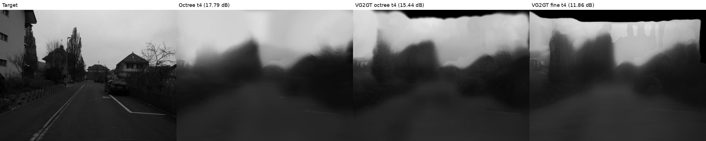

# VG²GT-style 事件高斯头：实现、训练与评测

## 协议

- 几何：冻结事件 DVLT（`eventscape_realm_20k/geometry/latest.pt`），不训练 backbone。
- 相机：**已知传感器内参 + 事件预测的相对源位姿**；不再用训练参考相机、测试拟合相机。
- 大角度目标：`target_offset=4`（源帧 i 与 i+2，目标帧 i+4；EventScape 同理）。目标在源区间之外，属于外推视角。
- 训练：DSEC + EventScape 混合 4,034 个窗口，12,000 步（fine-voxel 变体在第 4.6k 步停止）。
- 评测：同一批 test 窗口，`--known-source-intrinsics --target-offset 4`，只在目标帧上算指标。

## 结果

| 数据集 | 头 | target | PSNR ↑ | SSIM ↑ | LPIPS-VGG ↓ | LPIPS-Alex ↓ | 全零事件 PSNR | 高斯数 |
|---|---|---:|---:|---:|---:|---:|---:|---:|
| DSEC | octree（基线） | 2 | 17.56 | 0.708 | **0.617** | **0.530** | 9.36 | 208k |
| DSEC | octree | 4 | **17.79** | **0.722** | 0.634 | 0.606 | 9.47 | 219k |
| DSEC | VG²GT fine-voxel | 4 | 11.86 | 0.625 | 0.657 | 0.666 | 8.86 | 615k |
| DSEC | VG²GT octree hybrid | 4 | 15.44 | 0.702 | 0.640 | 0.624 | 10.49 | 437k |
| EventScape | octree（基线） | 2 | **17.88** | **0.592** | **0.619** | **0.610** | 12.98 | 329k |
| EventScape | octree | 4 | 17.78 | 0.589 | 0.641 | 0.667 | 13.40 | 328k |
| EventScape | VG²GT fine-voxel | 4 | 17.72 | 0.588 | 0.657 | 0.693 | 14.64 | 762k |
| EventScape | VG²GT octree hybrid | 4 | 17.66 | 0.587 | 0.655 | 0.676 | 13.25 | 655k |



## 结论

1. **相机协议仍是最大增益。** 预测相机到已知内参 + 预测位姿，DSEC 12.04→17.56 dB，EventScape 9.35→17.88 dB；内参是主因，位姿只差 0.02–0.11 dB。
2. **target 4 不是净收益。** 相对 target 2，DSEC PSNR +0.23 dB、SSIM +0.014，但 LPIPS-VGG 0.617→0.634；EventScape PSNR −0.10 dB、LPIPS 0.619→0.641。大角度监督没有把外观变好。
3. **fine-voxel VG²GT 在 DSEC 崩掉。** 固定 5 cm 网格把大量单视图/离群点变成高斯，中心错、尺度顶到 10 cm 上限。同窗 target-colour oracle 只有 12.62 dB，而 octree 是 21.68 dB，说明几何本身已经坏了，不是颜色头。
4. **octree hybrid 缩小了差距但仍输。** 保留 octree 多尺度选叶后，DSEC 15.44 dB，仍比 octree 低 2.35 dB；oracle 16.02 dB。self-splitting 把高斯数从 219k 翻到 437k，两个分裂高斯共享叶特征、中心/尺度近似，重叠后反而糊。没有 VG²GT 的 volume rendering、PointMLP 和 420K 迭代预算，只搬 head 不够。
5. **EventScape 区分度低。** 四种头都在 17.66–17.88 dB，DSEC 才是能暴露几何差异的 benchmark。
6. **渲染仍明显模糊。** 最好的 octree 也只有 17.79 dB，target-colour oracle 21.68 dB；外观头（灰度）而不是深度是当前主瓶颈。VG²GT-style 没有解决它。

## 可复现路径

| 内容 | 路径 |
|---|---|
| octree target4 12k | `/data/userwj/epf-runs/octree_target4_12k` |
| VG²GT fine-voxel | `/data/userwj/epf-runs/vg2gt_target4_12k`（4.6k 停止） |
| VG²GT octree hybrid | `/data/userwj/epf-runs/vg2gt_octree_target4_12k` |
| octree 12k 评测 | `/data/userwj/epf-runs/octree_target4_eval_12k` |
| fine-voxel 4.6k 评测 | `/data/userwj/epf-runs/vg2gt_target4_eval_46k` |
| hybrid 12k 评测 | `/data/userwj/epf-runs/vg2gt_octree_target4_12k` |
| 汇总 JSON/CSV | `results/vg2gt_head_comparison.json`、`.csv` |
| DSEC 诊断 | `/data/userwj/epf-runs/vg2gt_octree_dsec_diag.json`、`vg2gt_dsec_diag.json` |

复现命令（评测）：

```bash
python train_dsec_gaussians.py "$EPF_DSEC" "$EPF_ASSETS" \
  /data/userwj/projects/epf-deps/fast-feature-fields \
  /data/userwj/epf-runs/eventscape_realm_20k/geometry/latest.pt <out> \
  --eventscape-root /data/userwj/datasets/EventScape \
  --eventscape-cameras /data/userwj/epf-runs/eventscape_rgbd_cameras \
  --dsec-temporal-cameras /data/userwj/epf-runs/dsec_temporal_cameras \
  --geometry predicted --head octree --steps 0 --val-limit 1 --lpips \
  --known-source-intrinsics --target-offset 4 \
  --init-head /data/userwj/epf-runs/octree_target4_12k/latest.pt
```

## 下一步

保留 octree 几何和已知内参协议，把外观头改成 **per-pixel colour + 逐叶平均**：在 480×640 上预测灰度图，再按叶内点平均成高斯颜色，避免当前“先体素平均特征再回归灰度”的低频化。用 target-colour oracle 作为上界监控，目标先把 DSEC 从 21.7 dB 的几何上界往 20 dB 推。
