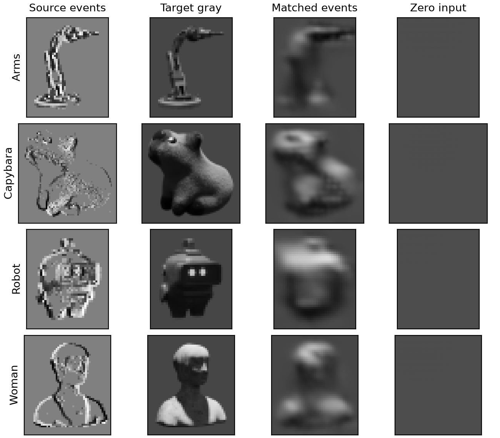

# Testing RGB Feature Transfer for Pose-Free Feed-Forward Gaussian Reconstruction from Events

## Abstract

An event camera records signed brightness changes. Recovering absolute appearance and consistent geometry from these changes requires information beyond a single local event count. We investigate whether training-time supervision from an RGB vision foundation model helps an event encoder infer a grayscale Gaussian scene. We develop a controlled two-view experiment in which the student receives only events and predicts the relative camera transform and Gaussian parameters in one forward pass. We evaluate interpolated views of held-out EV3DS objects and test whether replacing the events with packets from another scene changes reconstruction quality. Under a fixed-spacing synthetic protocol, multiview supervision improves foreground PSNR by 0.114 dB over resolution-matched single-image supervision and by 0.428 dB over a wrong-scene teacher. Relative-depth supervision improves depth accuracy while reducing rendering quality. On three real flights the frozen student scores below its zero-input control. These findings show how little a high full-frame rendering score alone establishes about the transfer of camera motion or object geometry.

## Introduction

An event packet can localize a moving contour precisely while leaving the intensity on either side underdetermined. Two packets acquired from different camera positions provide an additional constraint: a single 3D surface must explain the contour locations after reprojection. This constraint is useful only to the extent that the model recovers the camera motion. A canonical camera increment learned from an object turntable can give a misleading impression of reconstruction quality, particularly when the background fills most of the image.

We study this ambiguity in a feed-forward system that estimates camera motion and a renderable scene from two event packets. A frozen RGB teacher observes paired source views during training. Our experiments ask three questions. Does matching the teacher to the correct object matter? Do recurrent multiview features convey more information than image features at the same resolution? Does improving relative depth transfer also improve the appearance of a novel view? We measure these effects on held-out objects and test sensor transfer on indoor flights with independently measured camera motion.

## Related work

Wang et al. developed EvGGS for generalizable event-based Gaussian splatting and introduced synthetic data with grayscale, depth, pose and silhouette labels. This provides a natural appearance benchmark. Our reconstruction stage additionally estimates the relative source pose. We report the inputs consumed by each system when comparing their renders. [Wang et al., ICML 2024](https://proceedings.mlr.press/v235/wang24w.html)

Déjà View repeatedly refines RGB features with a shared transformer block. Déjà-Events already demonstrated that an event-only student can learn multiview depth, pose and pointmaps by matching a frozen Déjà View teacher. Distilling recurrent RGB features therefore serves as a baseline in our study. Our question concerns which transferred signals benefit Gaussian appearance under held-out rendering supervision. REALM studies RGB–event feature alignment, and F³ learns a predictive representation of event streams. We retain the released F³ field and analyze temporal event support in the Gaussian fusion stage. [Déjà View](https://arxiv.org/abs/2605.30215) · [Déjà-Events](https://arxiv.org/abs/2611.21302) · [REALM](https://github.com/utiasSTARS/REALM) · [Das et al., Science Robotics 2026](https://doi.org/10.1126/scirobotics.aec8218)

## Problem and method

Given event packets ending at two source times, the reconstruction network estimates one scene in the coordinate frame of the first camera. It uses the dataset's fixed intrinsics. RGB frames, source extrinsics and depth masks are available for supervision. Rendering a requested view requires a query transform with respect to the first camera. We evaluate reconstruction with a supplied query transform, so this experiment does not measure localization of an unknown target camera.

Each packet is partitioned into two temporal bins and two polarity channels. Log-transformed counts are encoded with shared convolutions. An ordered pair of feature grids predicts the relative camera translation and a six-dimensional rotation representation. Reversing the order of the feature grids gives the second source its own local appearance and geometry estimates. At each grid location the model predicts positive depth and Gaussian radius, opacity and grayscale intensity. We lift centers along calibrated rays, transform the second cloud into the first frame, project isotropic covariances through the perspective Jacobian and composite in depth order.

For RGB supervision, the left source image is passed through the frozen image encoder extracted from the published DVLT checkpoint. A learned projection maps the fused event grid into the teacher feature dimension. We minimize one minus the patchwise cosine similarity together with image and relative-pose losses. The initial experiment uses single-image features. We subsequently compare them with features from the final multiview loop under matched teacher inputs. [DVLT](https://github.com/nv-tlabs/dvlt)

## Experimental design

The initial coarse-grid experiments use the shared EV3DS trajectory text files for supervision and rendering. The dense experiments below use frame-specific camera records.

We take the first 12 training and six validation scenes in the EV3DS scene lists. Eight triplets per scene share the same temporal offsets. Events from the two source intervals end two frames before and after the target. Each arm receives 400 AdamW updates on batches of eight. We pair initializations and sampled batches between the zero-weight and 0.1-weight distillation arms. The student predicts 96 Gaussians and renders a 32 by 24 image. All windows are offline interpolations.

We compare full-frame training with a second objective that adds mean absolute error weighted by the fractional foreground coverage of each target pixel. Coverage is obtained by area pooling positive reference depths. Evaluation reports framewise PSNR on the full image and foreground-weighted PSNR. For the latter, squared errors are weighted by fractional coverage before computing the logarithm. We also cyclically permute scenes at fixed time or zero both event packets and render against the original target. Positive matched-minus-permuted PSNR indicates a benefit from matching event content to the scene.

## Pilot results

Mean validation PSNR (dB) over three paired training seeds (10, 11, 12). Each seed uses the same six held-out scenes.

| Training objective | Teacher weight | Full image | Foreground | Foreground, permuted | Foreground, zero |
|---|---:|---:|---:|---:|---:|
| Full frame | 0.0 | 27.573 | 16.339 | 16.343 | 16.290 |
| Full frame | 0.1 | 27.583 | 16.324 | 16.315 | 16.291 |
| Full frame + foreground | 0.0 | 25.930 | 15.946 | 15.053 | 16.322 |
| Full frame + foreground | 0.1 | 26.401 | 16.456 | 15.305 | 16.322 |

With full-frame supervision, adding the teacher changes mean foreground PSNR by −0.015 dB. With foreground-weighted supervision, the corresponding change is +0.510 dB. For the latter distilled model, permuting scenes reduces foreground PSNR by 1.151 dB, but removing all events reduces it by only 0.134 dB. This asymmetry matters: an incompatible event packet can actively degrade the prediction. A large permutation penalty alone therefore overstates the benefit of receiving the correct packet. The small gain over the zero-input control motivates testing whether a multiview teacher can transfer more scene-specific geometry.

### Camera-spacing stress test

We froze the foreground-weighted, distilled seed-10 checkpoint and changed the distance between the two source indices. We used the same six validation objects and eight starting frames. Reversing the packet order changes the desired reference frame while keeping the source evidence and target timestamp fixed. The four-frame forward input reproduces the training protocol. Mean relative rotation error rose from 0.168° there to 14.482° when source order was reversed. At an eight-frame forward spacing, error was 7.128°, compared with 7.007° for all-zero packets. At a sixteen-frame forward spacing the corresponding values were 21.545° and 21.411°. The small rotation error at the training spacing is consistent with learning the common camera increment. Novel-view PSNR was insensitive to this failure: reversing the four-frame pair increased full-frame PSNR from 26.647 to 26.902 dB. These measurements motivate separating camera generalization from image similarity in the evaluation.

### Transferring geometry from an RGB teacher

We strictly loaded the released DVLT model and ran its twelve inference steps on the two RGB source frames at 448 by 336 pixels. The head fits a camera transform to its predicted rays. We computed both poses relative to the first view before comparing rotations and translation directions. On the six validation scenes the teacher achieved a mean rotation error of 1.784° (identity prediction, 7.201°) and translation direction error of 5.975°. We median-scaled depth over valid foreground pixels jointly across each source pair. Teacher depth achieved 0.00894 absolute relative error, compared with 0.02592 for an oracle constant plane at the median reference depth. The teacher thus contains measurable information about foreground shape at this resolution.

We next concatenated a frozen F³ event field with the four count channels. The pretrained field processes packet-relative ages and native spatial coordinates centered on its training canvas. Each patch has 32 additional pooled channels. All arms below use this same input, architecture, foreground loss and three training seeds. To isolate the effect of multiview processing, we pooled the first source's spatial features immediately before and after DVLT's recurrent loop to the same 8 by 6 grid. The wrong-scene control cyclically shifts teacher targets across training objects at fixed frame index. [F³ implementation](https://github.com/grasp-lyrl/fast-feature-fields)

For direct depth supervision, we additionally sampled the teacher depth at each Gaussian center ray in both source views. We minimized the weighted absolute difference of log depths after subtracting the pair's weighted mean log residual, using a loss coefficient of 0.1. Uniform weighting gives all rays equal weight. The event-weighted arm uses one plus the logarithm of one plus the local mean event count, normalized over both grids. Both losses preserve the teacher's relative depth scale across the two views.

| Teacher target | Full PSNR | Foreground PSNR | Foreground gain over zero | Depth AbsRel ↓ |
|---|---:|---:|---:|---:|
| Low-resolution image tokens | 27.0152 | 16.5853 | 0.7415 | 0.0797 |
| Image tokens | 26.6644 | 16.4766 | 0.6432 | 0.0795 |
| Multiview tokens | 26.8125 | 16.5906 | 0.7596 | 0.0767 |
| Multiview, wrong scene | 26.4485 | 16.1624 | 0.2656 | 0.0829 |
| Multiview + relative depth | 25.0890 | 15.4014 | -0.5319 | 0.0391 |
| Multiview + event-weighted relative depth | 25.3908 | 15.7147 | -0.2152 | 0.0298 |

The recurrent teacher improved foreground PSNR by 0.114 dB over its resolution-matched image encoder and by 0.428 dB over the wrong-scene teacher. The small difference from low-resolution image tokens (0.005 dB) limits the practical claim for the loop. Explicit depth supervision reduced the student's aligned source-depth error but degraded novel-view intensity. Event weighting recovered 0.313 dB relative to uniform depth supervision. Even the lowest student depth error, 0.0298, exceeded the oracle median-plane error of 0.0192 on the same rays. Only 43 of 48 pairs contained a valid foreground sample on this coarse grid. We averaged within each scene before aggregating depth error, and evaluated depth separately from full-resolution teacher depth.

### Zero-shot transfer to real events

MVSEC contains synchronized events, images and ground truth for mobile platforms. [Zhu et al., IEEE Robotics and Automation Letters 2018](https://arxiv.org/abs/1801.10202)

We tested the frozen seed-10 models on 24 evenly spaced, pose-covered windows in each of MVSEC indoor_flying1, indoor_flying2, and indoor_flying3. The two source packets each span one image interval, and their endpoints are separated by four frames. We rectified both events and grayscale targets into a narrow virtual camera with the training intrinsics and the orientation of the raw left camera. We used the left-camera pose stream as camera-to-world, interpolated rotations by SLERP and translations linearly, and retained the original translation units. No MVSEC frames were used for optimization. These flights share an indoor environment; the result describes motion and sensor transfer within the selected field of view.

| Frozen model or reference | Matched PSNR | Zero-input PSNR | Rotation error |
|---|---:|---:|---:|
| Event counts + single-image teacher | 15.090 | 15.795 | 7.082° |
| F³ + multiview teacher | 14.784 | 15.016 | 7.036° |
| Identity rotation | — | — | 1.574° |
| Copy first source grayscale image | 29.016 | — | — |

Both students scored below their zero-input controls. Source-image copying, which uses additional photometric input, quantifies how little the grayscale target changes over these windows. These measurements provide no evidence of successful zero-shot transfer. A balanced training run with both source orders and four spacings also failed to resolve the pose ambiguity: at an eight-frame spacing, its mean rotation errors across both orders were 14.41° for matched and zero packets.

### Dense Gaussians and appearance fusion

The dense student encodes events at 128 by 96 pixels and predicts 1,536 anisotropic Gaussians. Position and opacity come from the shared geometry and appearance decoder. A separate head predicts three scales and a quaternion in the first-camera frame. We compare independent source appearance against two ways of combining grayscale estimates across views. We project each predicted center into the other camera, sample its grayscale and depth, and downweight its contribution according to relative depth disagreement. The event-weighted variant also weights the contribution by the ratio of local event support. All three variants use F³ inputs and the multiview RGB teacher during training. The table reports six-scene validation means over three seeds.

| Cross-view appearance | PSNR | Foreground PSNR | Foreground gain over zero | Aligned depth AbsRel |
|---|---:|---:|---:|---:|
| none | 26.1998 | 15.1062 | 0.9786 | 0.1808 |
| geometry | 25.4779 | 14.4981 | 0.4350 | 0.2130 |
| event | 25.2860 | 14.3443 | 0.2832 | 0.2091 |

Independent appearance estimates yield the highest foreground PSNR. The data give no support to the proposed event-weighted fusion rule at this stage. In the seed-10 event-weighted model the matched packets recover coarse structure that disappears when both packets are set to zero. Thin boundaries and local shading remain blurred.

**Camera metadata sensitivity.** We compared frame-specific camera records against the shared trajectory over the 144 sampled training and validation triplets. One four-frame relative rotation differs by approximately 116°. The Arms scene records an identity camera at frame 36 between two nonidentity orbital poses. We retain the window in the main table and report its influence separately. For the dense event-weighted seed-10 model, mean rotation error is 2.555° over all 48 validation pairs and 0.141° over the other 47. The teacher's rotation error against per-frame metadata is 4.117° over all pairs. This label sensitivity compounds the camera-prior issue in the earlier shared-trajectory evaluation.

**Native crop comparison.** We evaluated the seed-10 dense model with independent appearance on 32 matched target frames from four validation objects shared with an archived run of the released EvGGS checkpoint. Both systems render the central 512 by 480 crop at native sampling. Our system yielded 14.208 dB foreground PSNR, compared with 20.075 dB for EvGGS. Full-image scores were 23.867 and 11.679 dB respectively. EvGGS uses a black-background convention, two packets per source and reference source extrinsics; our student learns raw grayscale backgrounds and receives one packet per source. The reversal between full-frame and foreground rankings precludes treating full-frame scores as evidence of superior object reconstruction. This comparison uses different training budgets and source information.

**Real-event transfer at 128 by 96.** On the same 72 MVSEC windows, the dense event-weighted model obtained 13.428 dB with matched packets and 14.302 dB with empty packets. Relative rotation error was 7.296°, compared with 1.574° for identity. The increased Gaussian count alone did not resolve the domain gap.

## Scope of inference

The scene is the evaluation unit. Adjacent windows share content, and different seeds evaluate the same scenes. The official test split is reserved. A common trajectory and fixed intrinsics permit camera prediction from a learned prior. Relative pose accuracy on these clips alone cannot establish event-based pose estimation. The coarse spatial grid also limits measurements of edge fidelity. The current measurements motivate training on trajectories with substantial, varied camera motion. Evaluation against published event reconstruction systems on a predeclared protocol remains necessary. The deployment question is whether a learned scene improves foreground appearance and geometry relative to motion- and appearance-prior controls on real events.
