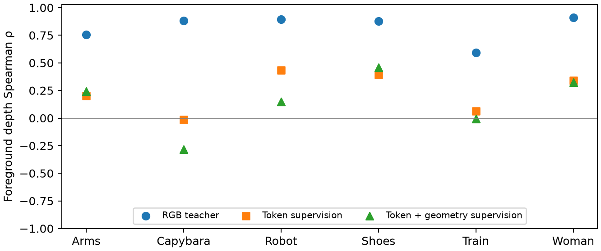
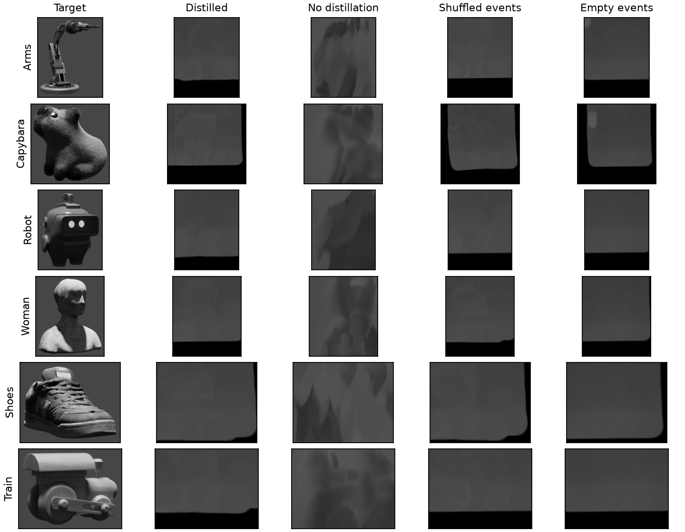

# Feed-Forward Gaussian Reconstruction from Events with a Distilled DVLT Backbone

## Abstract

We study whether a multiview RGB geometry model can supply the depth and camera motion needed to reconstruct a renderable Gaussian scene from event packets alone. Our student retains the DINOv2 encoder, recurrent multiview transformer, and geometry decoders of Déjà View (DVLT). It processes event voxels and predictive F³ fields through trainable adapters. During training, a frozen RGB copy of DVLT supplies final-token targets for both source views. A Gaussian head reads the event student's own multiview tokens, geometry predictions and local event features. The implementation evaluates a two-view scene in one forward pass with fixed internal refinement steps and no scene-specific optimization. We distinguish reconstruction tests of this architecture from earlier controls using a small convolutional student.

## Motivation and related work

Predicting Gaussian appearance from events requires recovering scene attributes that events constrain unevenly. Moving edges generate strong evidence of spatial structure. A locally constant surface can generate few events across a broad range of absolute intensities. RGB multiview transformers offer a training signal for geometry in this setting. The central question is whether their event-adapted features support consistent Gaussian appearance at a new view.

Déjà-Events adapts Déjà View to multiview events through event tokenization, low-rank adaptation of the image and recurrent encoders, sparsity-aware adaptive gates, and alignment of the student's final tokens to the RGB teacher. Its geometric outputs include pose, depth and pointmaps. Our design takes this event geometry backbone as its starting point and extends it with a renderable scene output. [Déjà-Events](https://arxiv.org/abs/2611.21302) · [Déjà View](https://arxiv.org/abs/2605.30215)

REALM motivates cross-modal alignment under spatial masking. F³ supplies local features learned to predict events. We use F³ in the event stem and the Gaussian head. EvGGS provides an external event-based Gaussian reconstruction baseline. Its architecture and camera inputs differ from the DVLT student evaluated here. [REALM](https://github.com/utiasSTARS/REALM) · [Fast Feature Field](https://doi.org/10.1126/scirobotics.aec8218) · [EvGGS](https://proceedings.mlr.press/v235/wang24w.html)

## Method

**Event tokenization.** Each source packet contributes signed polarity to five linearly interpolated temporal bins. The stem normalizes the bins separately, sums their positive, absolute and negative responses, normalizes each channel by its maximum, and applies a learned affine transform. A projection of the frozen F³ feature field adds an event-specific residual. The resulting three-channel tensor enters the student's DINOv2 patch encoder at 224 × 168 pixels. The spatial token grid has 16 × 12 positions per view.

**Multiview geometry.** We initialize the student from the released DVLT weights, including the geometry decoders. We add rank-16 updates to the query/key/value projections of all twelve DINOv2 blocks and to the frame and global attention branches of the shared recurrent block. Each branch adapts its step gate and applies trainable patchwise corrections to the attention and MLP residuals based on event density and step embeddings. Camera and register tokens retain the step-dependent gate. Twelve refinements produce the geometry tokens for both views. We decode depth and world rays and use DVLT's ray fitting procedure to recover source intrinsics and camera transforms. All Gaussian centers are expressed in the first source camera frame.

**Distillation.** A separate frozen teacher sees the frame-index-paired RGB source views. The student matches all final tokens, including camera and register tokens, using cosine distance and a teacher-magnitude-weighted absolute error. A progressively increasing fraction of event patch tokens is hidden before the shared transformer. We apply an additional loss to the hidden positions. This is our REALM-inspired masking variant. This initial experiment fixes the recurrence count; the released Déjà-Events study also explores varying the number of refinement steps. RGB and camera labels are absent from reconstruction inputs.

**Gaussian readout.** The head combines projected final patch tokens, F³ features and native event voxels. At each source pixel it predicts a bounded correction to DVLT depth, a grayscale intensity, opacity, three scale parameters and a quaternion. It backprojects corrected depth using DVLT's predicted intrinsics, then transforms the points into the first camera frame using DVLT's relative pose. A learned scalar calibrates depth and translation to the training scale. This configuration emits one candidate per pixel, or 614,400 Gaussians across two 640 × 480 sources. The head's sampling resolution is independent of DVLT's token grid.

## Experimental protocol

The integration experiment uses the first twelve training objects and six validation objects listed in the EV3DS split. For each object we sample eight triplets with four-frame spacing between sources and a midpoint target. We warm up the event adapters with token distillation, then jointly optimize distillation and foreground and full-frame rendering losses. During training and evaluation a reference query transform specifies the requested viewpoint. It never enters the reconstruction network. Reference foreground masks are used only in the loss and evaluation. We keep all 48 validation windows, including the previously identified anomalous Arms camera record.

The controls include empty event inputs and a matched event pair. We report image PSNR and foreground PSNR separately. Fixed source spacing and largely uniform synthetic backgrounds can otherwise conceal pose and appearance failures. The previously completed convolutional experiments, including their real-flight and EvGGS comparisons, concern a different student. Their numbers are recorded separately. [Convolutional pilot](convolutional_pilot.md)

## Initial results

After 32 distillation updates and 64 joint updates, the masked student reaches 11.67 dB full-image PSNR and 12.19 dB foreground PSNR across 48 held-out windows. With both event inputs zeroed the same weights yield 12.31 and 12.95 dB. Disabling masking during training yields 11.78 and 12.29 dB on matched events. This single-seed experiment shows no reconstruction gain from masking. The matched-versus-empty result also leaves unresolved whether the student recovers useful event-conditioned geometry. Gaussian count measures output capacity only.

On 72 zero-shot MVSEC windows sampled equally from three indoor flights, matched events yield 13.41 dB and 2.43 degrees mean relative rotation error. Empty inputs yield 13.09 dB and 1.88 degrees. Both protocols use grayscale rendering. These results motivate checking the teacher and student geometry on the same windows and isolating the effect of token distillation before attributing a reconstruction benefit to RGB priors.

## Where does geometry transfer fail?

We run the frozen RGB teacher and the masked event student on the same 48 held-out source pairs. We fit cameras from the decoded rays using the same random seed and measure rotation relative to the first view. For each of 96 source images we measure Spearman correlation between the decoded depth and the nearest-neighbor-resized reference depth over valid foreground pixels. This tests depth ordering before Gaussian readout and is invariant to a global scale factor.

| Training and input | Mean foreground depth rank correlation ↑ | Mean relative rotation error ↓ | Foreground rendering PSNR ↑ |
|---|---:|---:|---:|
| Frozen teacher, RGB | 0.819 | 6.05° | — |
| Masked token distillation, events | 0.237 | 9.65° | 12.19 dB |
| Masked token and decoded geometry distillation, events | 0.148 | 9.84° | 12.16 dB |

The third row adds mean absolute errors on teacher log-depth and six ray channels, averaged within each 14 × 14 patch, with unit weight for each term. The matched experiment keeps initialization, training windows, schedule and event-only inference fixed. The teacher recovers substantial foreground depth ordering on these objects. The additional supervision does not improve held-out foreground rendering or relative rotation at this training budget. Its empty-input foreground score is 12.83 dB. The apparent gap between teacher and student concerns these six held-out synthetic objects and this single training seed.

## Temporal pairing audit

Each training item pairs source PNGs at indices i and i + 4 with two NPY packets carrying the same scene and indices. We tested both source indices for all 12 training and 17 validation objects, totaling 464 packets. For each packet, we accumulated signed polarities per pixel and computed cosine similarity against log-grayscale differences for three candidate RGB intervals ending at i − 1, i, and i + 1. The mean similarities were 0.184, 0.782, and 0.146. The nominal interval had the highest similarity for 463 packets. The exception, Towel frame 43, favored the following interval and was retained in training.

The RGB video frame at each index also had the smallest mean pixel error against the corresponding scene PNG among the three candidates in all 464 cases. Repeating the event check on the independent H5 stream using the video rate and timestamp-defined intervals selected the nominal interval in all 464 cases. This audit supports visual alignment at the frame level. It does not establish a common physical clock for the H5 and NPY streams or subframe timestamp accuracy.

## Equal-budget distillation comparison

We train two students for 384 joint updates on the same 12 objects with identical initialization, sampled windows, 25% event-token masking and rendering supervision throughout. Both start from pretrained DVLT. One additionally receives RGB teacher token alignment with unit weight. We evaluate all 17 validation objects (136 windows). The shuffled condition replaces the entire source pair with events from the next validation object at the same frame indices.

| Training | Matched foreground PSNR | Shuffled foreground PSNR | Empty foreground PSNR | Matched full PSNR |
|---|---:|---:|---:|---:|
| RGB token distillation | 13.03 | 13.06 | 13.00 | 12.19 |
| Rendering supervision only | 13.88 | 13.76 | 13.40 | 21.09 |

The distilled student changes matched foreground PSNR by -0.84 dB on average, with positive differences on 4 of 17 objects. This comparison isolates the additional paired RGB token loss under one training schedule and one seed. It leaves the benefit of DVLT pretraining itself unmeasured. The figure shows center-target foreground crops for the first triplet of each of the first six validation objects in split order.

